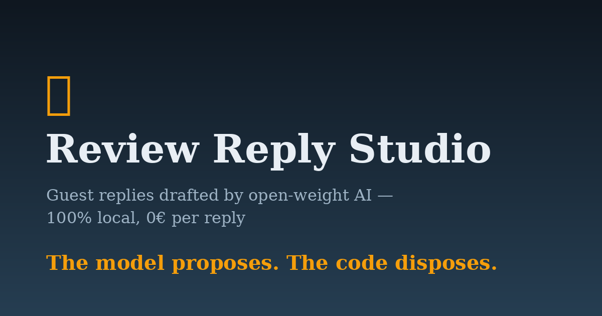
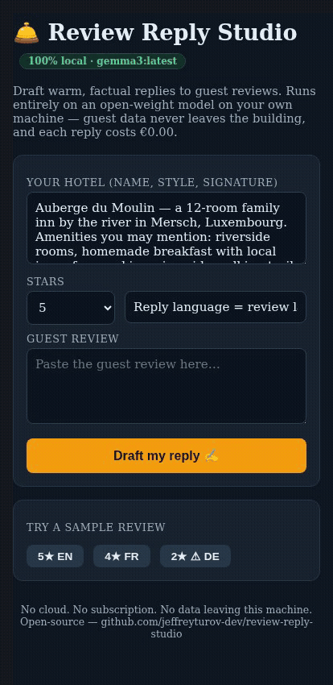

# 🛎️ Review Reply Studio

**Draft warm, factual replies to guest reviews — 100% locally, on open-weight models.**
Built for small independent hotels, B&Bs and guesthouses. Guest data never leaves the
machine. Each reply costs €0.00.



**Live demo:** https://aug-balance-specialty-flu.trycloudflare.com
*(temporary tunnel for the DEV Hacktoberfest Week 2 judging period)*

## Why it exists

I run a small business that sells AI tools to independent hotels. The two objections I
hear every week:

1. *"I can't send my guests' data to some API — GDPR."*
2. *"Another €50/month subscription for my 12 rooms? No."*

Review Reply Studio answers both: it runs an **open-weight model** (Gemma 3 via
[Ollama](https://ollama.com)) on the hotel's own machine, and it's MIT-licensed, so the
hotel *owns* it.

## The interesting part: the model proposes, the code disposes

A 4B open model will occasionally answer in the wrong language or echo a fact the
reviewer invented ("your wonderful spa" — the hotel has no spa). Instead of trusting
prompts alone, the app wraps generation in **deterministic guardrails**:

- **Language guard** — stopword-scored detection of the review language vs the draft
  language; mismatch → one regeneration with an explicit correction, then the draft is
  flagged `⚠ verify before posting` instead of pretending everything is fine.
- **No-invented-facts guard** — the hotel profile declares what the hotel *doesn't*
  have ("We do NOT have a spa, pool or restaurant"); any draft mentioning a forbidden
  amenity is regenerated once, then flagged.
- **Human-in-the-loop for serious reviews** — ≤ 2★ or safety/hygiene keywords always
  route to a human, draft attached.

Real output on the trap review *"The breakfast was amazing and the spa was wonderful"*:

> We are absolutely delighted to hear you enjoyed your stay with us at Auberge du
> Moulin! It warms our hearts to know you appreciated our homemade breakfast…
> *(no spa mentioned — the guardrail caught it)*



## Run it

```bash
pip install -r requirements.txt
# any Ollama server with a chat model; defaults shown:
export OLLAMA_HOST=http://127.0.0.1:11434
export OLLAMA_MODEL=gemma3:4b
python app.py
# open http://127.0.0.1:8787
```

No database, no accounts, no telemetry. One Python file, one HTML page.

## Stack

- **Open-weight model:** Gemma 3 (4B) via Ollama — runs on CPU, ~5–10s per draft
- **Backend:** Flask, stdlib HTTP only
- **Frontend:** a single HTML page
- **License:** MIT

Built during the DEV *Hacktoberfest Open-Source AI Challenge — Week 2: Side Hustle*
(Oct 12–18, 2026). #devchallenge #hf26challenge
